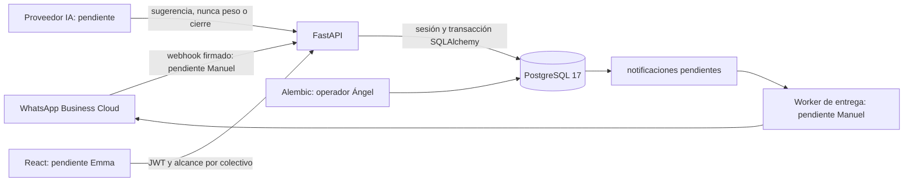
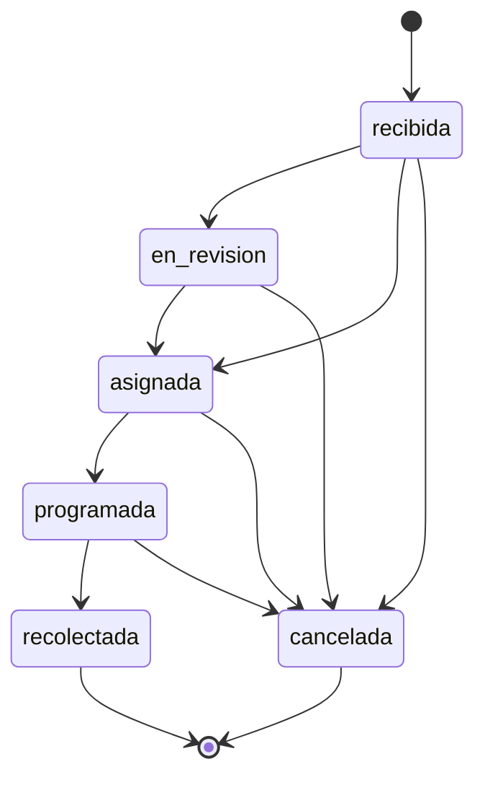

# Arquitectura y decisiones de integración

## Inspección inicial y alcance

El checkout recibido solo tenía `.git` y directorios de herramientas; no había commits locales, modelos Python, endpoints, React, migraciones, Compose ni credenciales. En la revisión de Git se identificó el remoto `https://github.com/emmapadiila/ecoreciclar.git`; no se presupone su contenido a partir del checkout vacío. Se creó una implementación de referencia sin borrar código de compañeros. El acuerdo con Breiner aún debe confirmarse: no se afirma que haya revisado este contrato. El PDF oficial de la Hackathon no fue consultado; esta implementación sigue el prompt y las dos propuestas aportadas por el usuario.

## Un solo esquema: conciliación de las propuestas

| Propuesta anterior | Modelo definitivo | Motivo |
|---|---|---|
| `miembros_colectivo` | `recolectores` | Nombre de la propuesta más reciente; también representa integrantes de huerta |
| `conversaciones_whatsapp` | `conversaciones` | Nombre reciente; una fila de contexto por usuario |
| `historial_solicitudes` | `historial_estados` | Nombre reciente; audita todas las transiciones, incluida creación |
| `colectivos.coordinador_id` | `coordinadores_colectivo` | Tabla de permisos activos permite sustituciones y más de un coordinador sin duplicar colectivos |
| `tipo_residuo`, `peso_estimado_kg` en solicitud | `materiales` + `solicitud_materiales` | Varios materiales por solicitud, catálogo de aceptación y prohibición de mezcla |
| `solicitudes.clasificacion_id` y referencia inversa | Solo `clasificaciones_ia.solicitud_id` nullable | Elimina dependencia circular; varios análisis pueden orientar una solicitud |
| `fecha_programada` + `hora_programada` | `asignaciones.programada_en TIMESTAMPTZ` | Un instante completo; rechaza entradas sin zona; presentación Bogotá |
| `message_id` | `meta_message_id UNIQUE NOT NULL` | Nombre reciente; deduplicación por ID de Meta |
| Estado de entrega únicamente | Entrega + `estado_procesamiento` | Recibir un evento no implica haber procesado sus efectos |
| Regla aprobada booleano | Booleano + `aprobada_por` | Aprobación administrativa trazable y reglas con vigencias no superpuestas |
| 15 tablas principales | 18 tablas | Las 15 recientes más coordinadores, materiales y detalle: necesarias para conservar las reglas previas |

No se crearon alias de tablas ni un segundo esquema. Los IDs usan BIGINT IDENTITY en lugar de BIGSERIAL (misma finalidad; generación estándar). Los importes se calculan con Decimal/NUMERIC, no floats. Las referencias ORM son FKs declarativas; no se requieren relaciones con carga automática para el contrato actual.

## Flujo previsto y partes implementadas

Implementado: API de referencia, credenciales web locales, JWT validado, contexto de actor, operaciones transaccionales, persistencia, servicio de registro idempotente de mensajes y outbox. Pendiente: integración del chatbot real, validación criptográfica de Meta, envío/recepción reales, IA, panel React y hosting. No hay endpoints simulados que digan que se envió WhatsApp.

La identidad vive en `usuarios.id` y `whatsapp_id UNIQUE` nullable. El helper `register_verified_message` solo se invoca tras verificar firma/remitente en una integración de confianza. Un remitente nuevo se registra **sin habilitar el piloto**. No se fusionan cuentas web/WhatsApp por nombre o teléfono escrito manualmente. Vincular una cuenta web preexistente requiere flujo de verificación pendiente con Manuel/Breiner.

Los puntos e historial dependen del usuario/solicitud, no del contexto de conversación. Reiniciar `datos_temporales` no pierde saldo. Un message ID repetido devuelve la misma fila; si corresponde a otro remitente se rechaza. El worker deberá bloquear la fila de mensaje, ejecutar efectos y marcar `procesado` en una sola transacción; si falla, reintentar el evento pendiente. Guardar un mensaje por sí solo no crea solicitudes ni garantiza entrega exactly-once de un proveedor externo.

## Estados y cierre atómico

Se conserva `recolectada` como estado terminal de cierre confirmado; no se añade un estado `cerrada` duplicado. No se permite reabrir ni cerrar dos veces. La asignación vigente es única por solicitud. Reasignar, reprogramar una solicitud ya programada y registrar canjes no forman parte de este contrato; requerirán eventos/migraciones propios, no sobrescribir registros actuales.

1. FastAPI valida JWT, usuario activo y piloto habilitado. Las consultas se filtran por colectivo o solicitante antes de leer/modificar.
2. Asignar/programar/cerrar bloquea la fila `solicitudes` con `SELECT FOR UPDATE`. Se fija `app.actor_id` mediante `set_config(..., true)` (solo durante la transacción).
3. Asignar exige material confirmado/activo/aceptado del flujo y miembro activo. FKs compuestas evitan una asignación de otro colectivo y una recolección de otra solicitud.
4. Cerrar inserta peso positivo finito. PostgreSQL fija la hora de cierre, valida responsable/programación y cambia el estado a `recolectada`.
5. Un trigger registra actor, estado anterior/nuevo y fecha. Actualizar/borrar historial o insertarlo directamente está prohibido.
6. Se selecciona la regla aprobada vigente para el instante real del cierre, bloqueada para lectura. Se acredita `round(peso_real_kg * puntos_por_kg, 2)` y se inserta notificación pendiente.
7. Un constraint trigger diferido exige que al COMMIT la recolección tenga puntos. Si falta regla, hay error de validación o falla el ledger, el cierre/estado/historial/notificación se revierten juntos.

`UNIQUE(recoleccion_id)` impide duplicar puntos y `UNIQUE(solicitud_id)` impide dos recolecciones. Las recolecciones y movimientos son inmutables. El segundo cierre concurrente espera el bloqueo, observa el estado terminal y devuelve 409. El permiso y la vigencia se comprueban también en PostgreSQL para evitar omisiones accidentales de otros clientes internos.

Las reglas aprobadas no pueden solaparse por colectivo; las modificaciones se serializan con un bloqueo del colectivo. Vigencia `[inicio, fin)`, fin NULL infinito. Una regla ya usada es inmutable: definir intervalos finitos acordados antes de usarla y crear versiones para el futuro. Una equivalencia aprobada de cero puntos es válida. No se inventa una equivalencia oficial.

## API para Breiner y Emma

| Método/ruta | Permiso | Entrada / respuesta relevante |
|---|---|---|
| `GET /health` | Público, sin datos | Consulta `SELECT 1`; status ok |
| `POST /auth/token` | Cuenta activa/autorizada, password hash | correo/password → JWT corto |
| `GET /materiales` | Autenticado/piloto | Catálogo aceptado y activo |
| `POST /solicitudes` | Solicitante autenticado/piloto | dirección, materiales `{material_id, confirmado, estimado_kg?}`, descripción/horario opcionales |
| `GET /solicitudes` | Residente: propias; coordinador: sus colectivos activos | Resumen sin dirección, máximo 100, offset |
| `GET /solicitudes/{id}` | Mismo filtro | Dirección privada solo al titular/coordinador |
| `GET /solicitudes/{id}/historial` | Mismo filtro | Transiciones auditadas |
| `POST /solicitudes/{id}/asignacion` | Coordinador del colectivo | recolector_id |
| `POST /solicitudes/{id}/programacion` | Coordinador del colectivo | programada_en con zona |
| `POST /solicitudes/{id}/cierre` | Coordinador del colectivo | peso_real_kg positivo, dos decimales |
| `POST /solicitudes/{id}/estado` | Coordinador del colectivo | en_revision/cancelada + observacion |
| `GET /mi-cuenta/puntos` | Titular autenticado | SUM ledger del usuario, no campo manipulable en usuario |

401: credenciales inválidas/usuario deshabilitado; 403: rol sin permiso operativo; 404: recurso ausente o ajeno; 409: conflicto de estado/regla; 422: entrada inválida. El cliente no envía actor/usuario/colectivo para forzar acceso. El rol administrador no obtiene acceso global a direcciones automáticamente. No hay elevación de permisos basada solo en un campo enviado desde React.

Swagger genera OpenAPI desde los esquemas reales. La API web fija origen web; el servicio interno verificado puede usar origen whatsapp. La IA puede persistir categoría sugerida y revisión pendiente, pero no aprueba materiales, peso ni puntos. Un material desconocido/no aceptado se rechaza para enrutamiento automático; el chatbot debe pedir revisión, no elegir arbitrariamente un colectivo.

## Sesiones, rol SQL y límites de seguridad

`get_session` abre una sesión/transacción por petición; commit al terminar correctamente y rollback ante excepción. No se comparten sesiones entre hilos ni se confirma parcialmente en servicios. `app.actor_id` es contexto de auditoría de un backend confiable, **no autenticación SQL ni RLS**. Los residentes/coordinadores nunca reciben acceso directo a PostgreSQL.

El servicio Docker usa `ecoconecta_app`, no superusuario. Provisión después de migrar: lectura, INSERT/UPDATE operativos y USAGE de secuencias. PostgreSQL exige algún permiso UPDATE para `FOR SHARE`; se concede UPDATE(id) en tablas de referencia, no sobre piloto, roles, contraseña, aceptación, factor o aprobación. Credenciales administrativas se reservan al operador. La conexión local de herramientas vía DATABASE_URL es administrativa; no desplegar Uvicorn públicamente con esa URL.

El actor se toma del JWT verificado (HS256 fijo, issuer, audience, expiración). Las cuentas web usan scrypt con sal, sin contraseñas demo predeterminadas. Los tokens expiran y las cuentas se revalidan en cada petición; revocación individual de tokens/SSO queda fuera del MVP. El despliegue público requiere TLS y limitación de login en proxy. No registrar cuerpos/headers ni parámetros SQL sensibles; los 409 no devuelven el SQL ni datos privados.

Teléfonos, direcciones, contenido de chat y claves de imagen son privados. No hay endpoint público de fotos ni URLs firmadas permanentes. El trabajador de imágenes debe autorizar acceso por usuario/colectivo y emitir URLs breves; no está implementado. Propuesta de retención de texto/contexto: 30 días, pendiente de autorización de la Fundación. No hay tarea automática de borrado; conservar IDs de deduplicación y trazabilidad según política aprobada, sin retener innecesariamente contenido.

`configuraciones` almacena JSON operativo, nunca secretos. El catálogo educativo no se renderiza aquí; Emma debe sanitizar contenido HTML si decide permitirlo. Los backups contienen datos privados y no deben subir a Git ni abrirse por URLs públicas.

## Plan si llega el backend de Breiner

1. Comparar modelos, tipos, nullability, estados, rutas y autenticación real con este contrato y guardar el acuerdo en el PR.
2. Mantener una sola metadata y cadena Alembic; reutilizar el manejo transaccional o integrar sus dependencias de sesión sin commits parciales.
3. Si existen tablas/datos, diseñar migración de renombre/backfill con mapa de IDs y prueba de restauración; no recrearlas ni hacer stamp de una base incompatible.
4. Conservar identidades WhatsApp y ledger; conciliar duplicados con revisión humana antes de aplicar UNIQUE. No fusionar por nombres.
5. Adaptar endpoints/serializadores a los nombres acordados, actualizar tests y OpenAPI; Emma/Manuel consumen el mismo contrato.
6. Ejecutar la suite y ensayar la migración/restauración en copia desidentificada antes del cambio real.

No se ha enviado ningún mensaje al equipo ni se ha supuesto una aprobación que no consta en la conversación.
