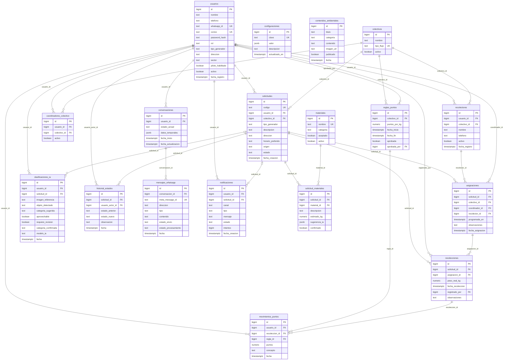

# Diagrama entidad–relación

Las 18 tablas comparten una sola base PostgreSQL. La relación IA → solicitud es unidireccional. Las relaciones compuestas de asignación y recolección también se detallan en el [diccionario](modelo-datos.md).

Las cardinalidades de hijos están simplificadas: `recolecciones.solicitud_id`, `asignaciones.solicitud_id`, `movimientos_puntos.recoleccion_id` y `conversaciones.usuario_id` son UNIQUE (0..1). No existen borrados en cascada.
